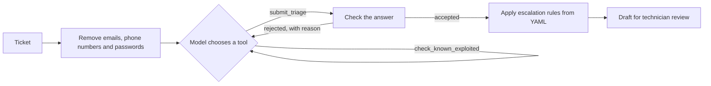

# MSP Triage Agent

An AI agent that triages IT service desk tickets for a managed service provider (MSP).
For each ticket it chooses the ticket type, queue and priority, decides whether a
technician needs to take over now, and drafts a reply that cites the knowledge base.
Nothing is sent automatically. A technician reviews every draft.

The same tickets can also be run through a fixed workflow and a keyword baseline, so the
evaluation shows what the agent adds and what it costs.

## What it does

The agent has four tools and decides which to use and in what order:

| Tool | What it does |
|---|---|
| `search_kb` | BM25 keyword search over 20 knowledge base articles |
| `find_similar_tickets` | Finds resolved past tickets with their queue, priority and resolution |
| `check_known_exploited` | Looks up the CISA Known Exploited Vulnerabilities (KEV) catalog by CVE number or product name |
| `submit_triage` | Submits the decision and draft reply, which ends the run |



## Agent or fixed workflow?

Not every ticket needs an agent. The project runs three approaches on the same tickets:

- **Keyword baseline**: rules from `config/triage.yaml`, no model. Shows what is possible
  without AI.
- **Workflow**: code always searches the knowledge base and past tickets, looks up any CVE
  numbers in the ticket, then makes one model call.
- **Agent**: the model decides which tools to call, up to six steps.

The workflow is cheaper and more predictable. The agent can follow up on what it finds, for
example checking the KEV catalog for a product named in the ticket when no CVE number is
given. The evaluation measures whether that is worth the extra calls.

## Guardrails

- **Ticket text is untrusted.** It is wrapped in `<ticket>` tags and the model is told to
  ignore instructions inside it. One test ticket tries a prompt injection.
- **Personal details are removed** (email addresses, phone numbers and `password: ...`)
  before any text reaches the model.
- **Answers are checked in code.** A submission is rejected and sent back to the model if it
  uses a queue, priority or type that does not exist, or cites a knowledge base article that
  did not appear in its search results.
- **Escalation rules are enforced in code.** P1 tickets, CVEs in the ticket that are in the
  KEV catalog, and low confidence always escalate. The rules can add an escalation but never
  remove one, so the model cannot talk its way out of them.
- **Limits.** At most six steps and three calls per tool. On the last step only
  `submit_triage` is offered. If the model still does not submit, the ticket goes to a
  technician.
- **Human review.** The tool only drafts. It has no way to send email or change systems.

## Quick start

Requires Python 3.11 or later.

```bash
pip install -e ".[dev,openai]"

# Offline, no API key needed
triage run --provider keyword --ticket T12
pytest
```

With DeepSeek:

```bash
cp .env.example .env          # then add DEEPSEEK_API_KEY
python scripts/download_kev.py   # optional: the full CISA KEV catalog
triage run --provider deepseek --ticket T21 --mode both
triage eval --provider deepseek --mode both --workers 4
```

Other providers: `--provider openai`, `azure` or `anthropic`, with the keys listed in
`.env.example`. `TRIAGE_MODEL` or `--model` picks the model or Azure deployment.

To triage your own tickets, export them as plain-text emails or CSV and convert them with
PowerShell:

```powershell
./scripts/Import-Tickets.ps1 -FolderPath ./export -OutputPath ./data/imported.jsonl
triage batch --provider deepseek --tickets data/imported.jsonl --out triaged.jsonl
```

With Docker:

```bash
docker build -t msp-triage-agent .
docker run --rm --env-file .env msp-triage-agent run --provider deepseek --ticket T13
```

## Evaluation

`eval/tickets.jsonl` has 40 tickets that I wrote and labelled, covering all six queues, four
priorities and four ticket types, including a ransomware note, a prompt injection attempt,
CVE questions and tickets with personal details. Ten of them are marked as holdout. They
were written at the same time as the others but are not used when adjusting prompts or
rules, and their results are reported separately.

Escalation labels follow the rule given to the model: escalate P1 tickets, active security
incidents and known exploited vulnerabilities.

Keyword baseline (no model, workflow mode):

| Metric | Dev (30) | Holdout (10) |
|---|---|---|
| Ticket type | 70% | 60% |
| Queue | 73% | 40% |
| Priority (exact) | 70% | 60% |
| Priority (within one level) | 87% | 90% |
| Expected KB article cited | 65% | 25% |
| Escalation precision | 80% | 0% |
| Escalation recall | 50% | 0% |

Model results: to be added after the first run.

For a larger check of ticket type only, `scripts/download_hf_tickets.py` samples English
tickets from the
[Tobi-Bueck/customer-support-tickets](https://huggingface.co/datasets/Tobi-Bueck/customer-support-tickets)
dataset on Hugging Face. That dataset appears to be synthetic and is licensed CC BY-NC 4.0,
so it is downloaded locally and not included here. Its queues and priorities use a
different scheme, so only the ticket type is scored.

## Limitations

- 40 labelled tickets is a small set, and the labels are one person's judgement. Priority
  in particular is often arguable, which is why "within one level" is also reported.
- The knowledge base is 20 short, generic articles written for this project.
- Retrieval is BM25 keyword search. There are no embeddings or vector database.
- `data/kev_fixture.json` is a small, simplified sample used for tests and offline runs.
  Use `scripts/download_kev.py` for real data.
- The PowerShell importer reads plain-text emails and CSV only. Multipart MIME emails are
  not decoded.
- Phone number redaction is pattern-based and will miss some formats.

## Project layout

```
config/triage.yaml      queues, priorities, escalation rules and limits
kb/                     knowledge base articles (Markdown with front matter)
data/                   resolved ticket history and the KEV test fixture
eval/tickets.jsonl      40 labelled tickets
src/triage_agent/       agent loop, tools, provider adapters, evaluation and CLI
scripts/                data downloads and the PowerShell importer
tests/                  pytest suite, runs offline with scripted and keyword models
```

The provider adapters share one small interface, so the agent loop is the same for
DeepSeek, OpenAI, Azure OpenAI and Anthropic. Tests use a scripted model and fake clients,
so CI needs no API keys.

Built with the help of AI coding assistants.
